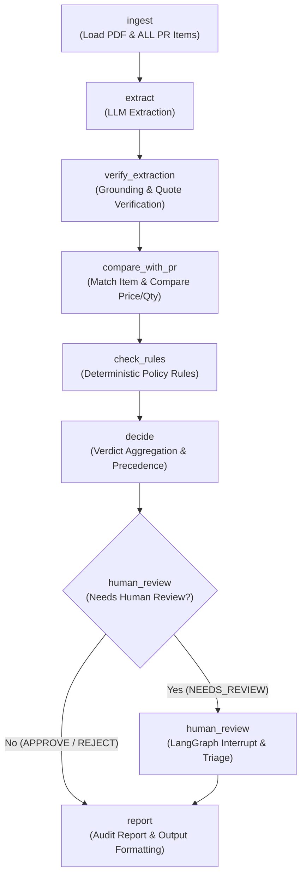

# Design Document: Supplier Document Checker (`supplier-check`)

## 1. Problem Statement

In garment manufacturing and retail operations, procurement teams handle numerous supplier quotations daily for raw materials and trims (fabrics, zippers, thread, poly bags, and cartons). Verifying these quotations against the internal purchase request (PR) and company procurement policies requires checking complex price tolerances, delivery timelines, payment terms, statutory tax registrations, and arithmetic accuracy.

Doing this manually is slow, error-prone, and inconsistent. The **`supplier-check`** pipeline automates this verification. It ingests supplier quotation packs (PDFs), extracts structured quotation fields, and evaluates them against strict, deterministic procurement rules. Every supplier quotation receives one of three clear verdicts:
1. **`APPROVE`** (*"Approve"*): Meets all pricing, delivery, payment, compliance, and arithmetic criteria.
2. **`REJECT`** (*"Reject"*): Violates critical company rules (e.g., price more than 3% above budget, excessive advance payment, missing penalty clause, missing tax registrations, or delivery exceeding 45 days).
3. **`NEEDS_REVIEW`** (*"Needs a person to check"*): Fails minor tolerance thresholds, contains unverified or ambiguous terms, has calculation errors, or has missing critical information requiring human buyer judgement.

To ensure strict operational integrity:
- **No free-running agents**: The pipeline is a fixed, deterministic sequence.
- **Strict separation of concerns**: An LLM is used **strictly** to extract raw structured text and quotes from documents.
- **Deterministic Python logic**: All calculations, tolerance thresholds, and rule evaluations are executed in plain Python using `Decimal` arithmetic.
- **"Never Guess" policy**: If any required field is missing, ambiguous, or unverifiable, the system immediately flags the pack for human review (`NEEDS_REVIEW`).
- **Verbatim evidence quotes & Absence convention**: Every decision reason cites the exact, unmodified text from the supplier quotation. When a rule triggers due to the absence of a required clause (e.g. no penalty clause or missing TIN/BIN), absence explanations are kept **OUT** of `evidence_quote`. Instead:
  - `evidence_quote`: Quotes the verbatim relevant section (e.g. Terms and Conditions text) or is `None`.
  - `absence_note`: Stores an explicit human explanation (e.g. `"No clause matching 'late delivery penalty' found in terms and conditions"`).
  - **Grounding check rule**: Grounding verification **only** verifies `evidence_quote`, never `absence_note`. Never invent or mutate a quote.

---

## 2. Pipeline Architecture & Workflow

The architecture is implemented as a fixed, linear LangGraph state graph. In Phase 5, `human_review` is implemented as a real pause/resume mechanism using LangGraph's native `interrupt()` function to wait for human reviewer sign-off or notes before final reporting.



---

## 3. Pipeline Nodes Specification

| Node Name | Purpose | Inputs | Outputs | Uses LLM? | Failure / Fallback Behaviour |
| :--- | :--- | :--- | :--- | :--- | :--- |
| **`ingest`** | Reads the raw supplier pack PDF and loads **ALL** line items from `purchase-request.csv`. Extracts full plain text from PDF. Does **not** select the item yet (item matching is deferred to `compare_with_pr`). | `pdf_path: Path`, `pr_csv_path: Path` | `raw_document_text: str`, `pr_items: list[PurchaseRequestItem]` | **No** (pypdf + csv parser) | File missing, corrupt, or unreadable PDF: raises immediate `IngestError`, logs error, outputs `NEEDS_REVIEW` with unreadable file note. |
| **`extract`** | Extracts quotation metadata, pricing, tax, and terms into structured Pydantic schema using structured outputs / tool calling. | `raw_document_text: str` | `extracted_quote: ExtractedQuote` (unverified) | **Yes** (Strict extraction only) | API error or schema parse error: retries once, then halts and outputs `NEEDS_REVIEW` with parsing failure reason. |
| **`verify_extraction`** | Computes `grounded: bool` in code. Checks that every non-empty `evidence_quote` exists verbatim as a substring in `raw_document_text`. **Only verifies `evidence_quote`, never `absence_note`.** | `raw_document_text: str`, `extracted_quote: ExtractedQuote` | `verified_quote: ExtractedQuote`, `grounding_errors: list[str]` | **No** (Plain Python string search) | If any non-empty `evidence_quote` is missing from document text, sets `grounded = False` and triggers `NEEDS_REVIEW`. |
| **`compare_with_pr`** | Identifies matching line item from `pr_items` via `reference_pr`, `item_code`, `description`, and `unit`. Evaluates `RULE_REV_12_ITEM_MATCH` and performs `Decimal` price/qty comparisons. | `verified_quote: ExtractedQuote`, `pr_items: list[PurchaseRequestItem]` | `matched_pr_item: Optional[PurchaseRequestItem]`, `comparison_results: list[RuleResult]` | **No** (Deterministic math & string matching) | If item cannot be matched, `line_item_count` is `None` or `> 1`, or fields mismatch, triggers `REVIEW`. |
| **`check_rules`** | Evaluates statutory compliance, commercial terms, delivery schedules, penalties, VAT presentation, and arithmetic integrity. | `verified_quote: ExtractedQuote`, `rules_config: RulesConfig` | `policy_results: list[RuleResult]` | **No** (Deterministic Decimal math & logic) | Evaluates all rules independently; every violation is recorded. Ambiguous or missing values yield `REVIEW`. |
| **`decide`** | Consolidates all `RuleResult` items from PR comparison and rule checks, evaluates precedence, and produces final verdict and reasons. | `comparison_results`, `policy_results`, `grounding_errors` | `decision: Decision` | **No** (Deterministic logic) | Always completes deterministically following precedence rules. |
| **`human_review`** | Triggered only if verdict is `NEEDS_REVIEW`. In Phase 5, executes a LangGraph `interrupt()` pausing pipeline execution for buyer review. | `decision: Decision`, `verified_quote: ExtractedQuote` | `human_review_payload: dict` | **No** (LangGraph interrupt) | Pauses until resumed with human review resolution. |
| **`report`** | Formats human-readable console and markdown report with exact quotation evidence citations and audit log. | `decision: Decision`, `verified_quote: ExtractedQuote` | `final_report: AuditReport` | **No** (Rich / Markdown generation) | Outputs structured audit report. |

---

## 4. Pydantic Data Models

Every extracted field is wrapped in a container `FieldEvidence[T]` with extraction `status` (`FOUND`, `ABSENT`, or `UNCERTAIN`), code-computed `grounded: bool`, exact verbatim `evidence_quote`, and an optional `absence_note`.

```python
from decimal import Decimal
from enum import StrEnum
from typing import Generic, TypeVar
from pydantic import BaseModel, ConfigDict, Field, model_validator

T = TypeVar("T")


class FieldStatus(StrEnum):
    FOUND = "FOUND"
    ABSENT = "ABSENT"
    UNCERTAIN = "UNCERTAIN"


class Severity(StrEnum):
    PASS = "PASS"
    REVIEW = "REVIEW"
    REJECT = "REJECT"


class Verdict(StrEnum):
    APPROVE = "APPROVE"
    REJECT = "REJECT"
    NEEDS_REVIEW = "NEEDS_REVIEW"

    @property
    def display_name(self) -> str:
        mapping = {
            Verdict.APPROVE: "Approve",
            Verdict.REJECT: "Reject",
            Verdict.NEEDS_REVIEW: "Needs a person to check",
        }
        return mapping[self]


class FieldEvidence(BaseModel, Generic[T]):
    """Container wrapping an extracted value with status and supporting verbatim quote."""

    model_config = ConfigDict(arbitrary_types_allowed=True)

    status: FieldStatus
    value: T | None = None
    evidence_quote: str | None = None
    absence_note: str | None = None  # Kept separate from quote; never checked by grounding
    grounded: bool = False  # Code-computed; NEVER populated by the LLM

    @model_validator(mode="after")
    def validate_invariants(self) -> "FieldEvidence[T]":
        if self.status == FieldStatus.FOUND:
            if self.value is None:
                raise ValueError("status FOUND requires a non-None value")
            if isinstance(self.value, str) and not self.value.strip():
                raise ValueError("status FOUND requires a non-empty string value")
            if not self.evidence_quote or not self.evidence_quote.strip():
                raise ValueError("status FOUND requires a non-empty evidence_quote")
        elif self.status == FieldStatus.ABSENT:
            if self.value is not None:
                raise ValueError("status ABSENT requires value to be None")
        # UNCERTAIN may carry anything
        return self


class ExtractedQuote(BaseModel):
    """Raw structured quotation extracted by the LLM from supplier pack text."""

    supplier_name: FieldEvidence[str]
    quotation_no: FieldEvidence[str]
    quote_date: FieldEvidence[str]  # ISO format string (YYYY-MM-DD)
    reference_pr: FieldEvidence[str]
    line_item_count: int | None = Field(
        default=None,
        ge=0,
        description="Total line items found, or None if undetermined.",
    )
    item_code: FieldEvidence[str]
    description: FieldEvidence[str]
    quantity: FieldEvidence[Decimal]
    unit: FieldEvidence[str]
    unit_price: FieldEvidence[Decimal]
    subtotal: FieldEvidence[Decimal]
    vat_amount: FieldEvidence[Decimal]
    vat_percent: FieldEvidence[Decimal]
    vat_shown_separately: FieldEvidence[bool]
    total: FieldEvidence[Decimal]
    tin: FieldEvidence[str]
    bin: FieldEvidence[str]
    advance_percent: FieldEvidence[Decimal]  # Absence = UNCERTAIN
    payment_terms_text: FieldEvidence[str]
    payment_days: FieldEvidence[int]
    delivery_terms_text: FieldEvidence[str]
    delivery_days: FieldEvidence[int]
    late_penalty_percent_per_week: FieldEvidence[Decimal]
    late_penalty_clause_present: FieldEvidence[bool]
    late_penalty_specifies_order_value: FieldEvidence[bool]
    validity_days: FieldEvidence[int]


class RuleResult(BaseModel):
    rule_id: str
    severity: Severity  # REJECT, REVIEW, or PASS
    message: str
    evidence_quote: str


class Decision(BaseModel):
    verdict: Verdict
    triggered_rules: list[RuleResult] = Field(default_factory=list)
    reasons: list[str] = Field(default_factory=list)

    @property
    def display_verdict(self) -> str:
        return self.verdict.display_name
```

---

## 5. Decision Precedence & Multi-Rule Reporting

The decision engine applies strict, deterministic short-circuit-free evaluation:

1. **Comprehensive Evaluation**: Every rule is evaluated against the quotation; evaluation **never** halts on the first violation. All applicable rule findings are collected into `triggered_rules`.
2. **Precedence Hierarchy**:
   - **`REJECT`** takes top priority: If **any** rule triggers `Severity.REJECT`, the final verdict is `Verdict.REJECT` (*"Reject"*).
   - **`NEEDS_REVIEW`** takes second priority: If no `REJECT` rule was triggered, but **any** rule triggered `Severity.REVIEW`, or any required field is uncertain/ungrounded, the final verdict is `Verdict.NEEDS_REVIEW` (*"Needs a person to check"*).
   - **`APPROVE`** is granted **only if**: No `REJECT` rules fired AND no `REVIEW` rules fired AND all calculations and terms are fully verified (*"Approve"*).
3. **Audit Trail**: Every triggered rule contributes its verbatim supporting quote to `reasons` so that human auditors see full justification for the decision.

---

## 6. Complete Procurement Rule Table

All thresholds and policies are read directly from `config/rules.yaml`. Price comparisons use pure `Decimal` arithmetic:
`price_threshold = max_price * (Decimal("1.0") + Decimal(price_tolerance_pct) / Decimal("100.0"))`.

| Rule ID | Rule Source & Description | Severity | Exact Threshold & Condition (Decimal) | Edge Cases & Handling |
| :--- | :--- | :--- | :--- | :--- |
| **`RULE_REJ_01_PRICE_MAX`** | Unit price > 3% above PR max unit price | `REJECT` | `unit_price > max_price * (1 + Decimal("0.03"))` | E.g. Pack 03: 229 vs 210 (+9.04%) triggers REJECT. |
| **`RULE_REJ_02_ADVANCE_MAX`** | Advance payment > 20% | `REJECT` | `advance_percent > Decimal("20.0")` | E.g. Pack 05: 40% advance triggers REJECT. |
| **`RULE_REJ_03_NO_PENALTY`** | No late-delivery penalty clause | `REJECT` | `not late_penalty_clause_present` | E.g. Pack 06: No delay clause triggers REJECT. `absence_note` records absence. |
| **`RULE_REJ_04_PENALTY_RATE`** | Penalty rate < 0.5% per week | `REJECT` | `late_penalty_percent_per_week < Decimal("0.5")` | If clause exists but offers < 0.5% per week, triggers REJECT. |
| **`RULE_REJ_05_TAX_ID`** | Supplier TIN or BIN is missing | `REJECT` | Evaluates according to `tin_bin_policy`: `reject_if_either_missing` | If TIN is ABSENT or BIN is ABSENT, trigger REJECT. E.g. Pack 08 triggers REJECT. `absence_note` records absence. |
| **`RULE_REJ_06_DELIVERY_MAX`** | Delivery promised > 45 days after PO | `REJECT` | `delivery_days > 45` | E.g. Pack 10: 60 days triggers REJECT. |
| **`RULE_REV_01_PRICE_TOLERANCE`**| Unit price above PR max by <= 3% | `REVIEW` | `max_price < unit_price <= max_price * (1 + Decimal("0.03"))` | **Exact 3% over = REVIEW**. E.g. Pack 04: 6.65 vs 6.50 (+2.31%) triggers REVIEW. |
| **`RULE_REV_02_QTY_TOLERANCE`** | Quantity differs from requested by > 5% | `REVIEW` | `abs(qty - req_qty) / req_qty > Decimal("0.05")` | E.g. Pack 07: 16,500 vs 20,000 (-17.5%) triggers REVIEW. |
| **`RULE_REV_03_PAYMENT_TERMS`** | Payment terms outside 30–60 days or unclear | `REVIEW` | `payment_days is None or payment_days < 30 or payment_days > 60` | E.g. Pack 09: "within 30 to 90 days as agreed" is unclear/range >60 -> triggers REVIEW. |
| **`RULE_REV_04_DELIVERY_RANGE`**| Delivery promised in 31 to 45 days | `REVIEW` | `31 <= delivery_days <= 45` | Boundary: <= 30 is PASS, 31 to 45 is REVIEW, > 45 is REJECT. |
| **`RULE_REV_05_VAT_PRESENTATION`**| VAT is not shown separately at 15% | `REVIEW` | `not vat_shown_separately or vat_percent != Decimal("15.0")` | E.g. Pack 10: "Unit price (BDT, VAT included)" without separate 15% breakdown triggers REVIEW. |
| **`RULE_REV_06_MATH_SUBTOTAL`** | Subtotal does not equal Qty × Unit Price | `REVIEW` | `abs(subtotal - (qty * unit_price)) > tolerance` | Tolerance in `rules.yaml` (`Decimal("1.00")`). E.g. Pack 09: 50,000 × 6.40 = 320,000 vs stated 322,000 triggers REVIEW. |
| **`RULE_REV_07_MATH_VAT`** | VAT amount does not equal 15% of Subtotal | `REVIEW` | `abs(vat_amount - (Decimal("0.15") * subtotal)) > tolerance` | Tolerance in `rules.yaml`. |
| **`RULE_REV_08_MATH_TOTAL`** | Total does not equal Subtotal + VAT | `REVIEW` | `abs(total - (subtotal + vat_amount)) > tolerance` | Tolerance in `rules.yaml`. |
| **`RULE_REV_09_VALIDITY`** | Quotation validity < 30 days | `REVIEW` | `validity_days is None or validity_days < 30` | If validity not stated or < 30 days, triggers REVIEW. |
| **`RULE_REV_10_PENALTY_AMBIGUOUS`**| Penalty does not explicitly specify "order value" | `REVIEW` | Evaluates according to `penalty_base_unstated_policy: review` | When penalty clause exists but `late_penalty_specifies_order_value` is False (Pack 08), triggers REVIEW. |
| **`RULE_REV_11_UNVERIFIABLE_FIELD`**| Field required by a rule is UNCERTAIN/missing where None is not a legitimate state | `REVIEW` | `field.status == UNCERTAIN or (field.status == ABSENT and not is_legitimate_none)` | Fires only when a field required by a rule is missing or uncertain and `None` is not a legitimate state for it. (Legitimate None cases: TIN/BIN handled by REJ_05, penalty rate when no clause exists handled by REJ_03, VAT fields when VAT is not shown separately handled by REV_05). |
| **`RULE_REV_12_ITEM_MATCH`** | PR number, item code, description, and unit match | `REVIEW` | `ref_pr != pr_number or item_code != pr_item.item_code or line_item_count is None or line_item_count > 1` | Verified against `pr_items`. Any mismatch, undetermined line item count (`line_item_count is None`), or multiple items (`line_item_count > 1`) triggers REVIEW. |

---

## 7. Normalisation Rules & Absence Convention

1. **Time Periods**:
   - `"X weeks"`: converted to `X * 7` days (e.g., `"4 weeks"` = 28 days).
   - `"within 24 days of receiving PO"` -> `24` days.
2. **Ambiguous Ranges**:
   - `"within 30 to 90 days as agreed"` -> `payment_days` status set to `UNCERTAIN` (triggers `RULE_REV_03_PAYMENT_TERMS`).
3. **Statutory Registrations (TIN/BIN)**:
   - Text containing `"Supplier registration details available on request"` or omitted -> `status = ABSENT`, `value = None`, `absence_note = "Registration details available on request; TIN/BIN not provided"` (triggers `RULE_REJ_05_TAX_ID`).
4. **Advance Payments**:
   - Absence of advance payment term = `status: UNCERTAIN` (never assume 0%).
   - `"No advance payment required"` -> `status: FOUND`, `value: Decimal("0.0")` (falsy `Decimal("0.0")` is valid FOUND value).
5. **Absence Convention**:
   - Absence explanations must stay **OUT** of `evidence_quote`.
   - `evidence_quote` contains only verbatim quotes from the text or `None`.
   - `absence_note` contains the explicit explanation.
   - The grounding check strictly checks `evidence_quote` against document text; it **never** verifies `absence_note`.

---

## 8. Risks, Ambiguities & Documented Assumptions

| Item / Ambiguity | Risk | Documented Resolution & Pipeline Behavior |
| :--- | :--- | :--- |
| **TIN / BIN Policy** | Document rule states "TIN or BIN is missing." | **Resolved**: Read from `rules.yaml` (`tin_bin_policy: reject_if_either_missing`). If either is ABSENT, triggers `RULE_REJ_05_TAX_ID`. |
| **Unstated Penalty Base** | Note 1 requires penalty to be "0.5% of order value per week", but quotes may say "0.5% per week of delay". | **Resolved**: Read from `rules.yaml` (`penalty_base_unstated_policy: review`). Triggers `RULE_REV_10_PENALTY_AMBIGUOUS`. |
| **VAT-Inclusive Unit Price** | Pack 10 specifies "Unit price (BDT, VAT included)". | **Documented Assumption**: A VAT-inclusive unit price is not strictly like-for-like with the PR maximum unit price (which is ex-VAT). However, Pack 10 is already caught by `RULE_REV_05_VAT_PRESENTATION` (VAT not shown separately at 15%) and `RULE_REJ_06_DELIVERY_MAX` (60 days > 45 days). |
| **Multi-Item or Undetermined Quotes** | Supplier packs could contain multiple items or undetectable line item structures. | **Resolved**: Handled by `RULE_REV_12_ITEM_MATCH`. Quotes where `line_item_count` is `None` or `> 1` trigger `REVIEW` for human triage. |
| **Human Review Pause** | Human review in automated pipelines can easily become a no-op log statement. | **Resolved**: In Phase 5, `human_review` is implemented as an explicit LangGraph `interrupt()` pause/resume point. |

---

## 9. Expected Test Verdicts Across Sample Packs

| Pack | Supplier Name | Expected Verdict | Primary Triggered Rules & Rationale |
| :--- | :--- | :--- | :--- |
| **Pack 01** | Padma Textile Mills Ltd | **`APPROVE`** | Price (472 <= 480), Qty (12k), Advance (10%), Delivery (24d), Penalty (1%), TIN/BIN present, Math accurate. |
| **Pack 02** | Jamuna Trims and Accessories | **`APPROVE`** | Price (36 <= 38), Qty (20k), Advance (0%), Delivery (21d), Penalty (0.75%), TIN/BIN present, Math accurate. |
| **Pack 03** | Karnaphuli Yarn Traders | **`REJECT`** | `RULE_REJ_01_PRICE_MAX`: Unit price 229.00 is 9.04% over PR max price (210.00). |
| **Pack 04** | Surma Packaging Industries | **`NEEDS_REVIEW`** | `RULE_REV_01_PRICE_TOLERANCE`: Unit price 6.65 is 2.31% over PR max price (6.50) (within 3% tolerance). |
| **Pack 05** | Meghna Carton Works | **`REJECT`** | `RULE_REJ_02_ADVANCE_MAX`: 40% advance required (max allowed is 20%). |
| **Pack 06** | Teesta Fabrics Ltd | **`REJECT`** | `RULE_REJ_03_NO_PENALTY`: Quotation has no late-delivery penalty clause (absence convention used). |
| **Pack 07** | Rupsha Zipper Factory | **`NEEDS_REVIEW`** | `RULE_REV_02_QTY_TOLERANCE`: Offered 16,500 pcs vs requested 20,000 pcs (-17.5% diff > 5%). |
| **Pack 08** | Bhairab Thread and Co | **`REJECT`** & **`REVIEW`** | `RULE_REJ_05_TAX_ID` (Missing TIN/BIN) + `RULE_REV_10_PENALTY_AMBIGUOUS` (Penalty lacks "of order value"). |
| **Pack 09** | Dhaleshwari Poly Pack | **`NEEDS_REVIEW`** | `RULE_REV_06_MATH_SUBTOTAL` (Stated 322,000 vs calculated 320,000) + `RULE_REV_03_PAYMENT_TERMS` (30-90 days). |
| **Pack 10** | Kushiyara Box Industries | **`REJECT`** & **`REVIEW`** | `RULE_REJ_06_DELIVERY_MAX` (60 days > 45 days) + `RULE_REV_05_VAT_PRESENTATION` (VAT included in unit price). |
